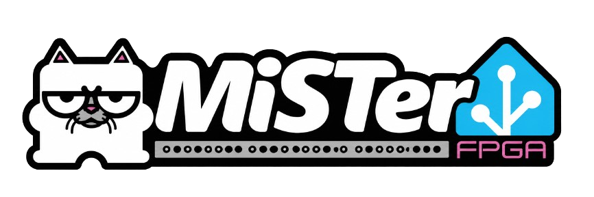

<p align="center">
  
</p>

# MiSTer FPGA for Home Assistant

[](https://github.com/hudsonbrendon/ha-mister-fpga/actions/workflows/tests.yml)
[](https://github.com/hudsonbrendon/ha-mister-fpga/actions/workflows/hassfest.yml)
[](https://github.com/hudsonbrendon/ha-mister-fpga/actions/workflows/validate.yml)
[](https://hacs.xyz/)
[](https://github.com/hudsonbrendon/ha-mister-fpga/releases)
[](LICENSE)

Monitor and control a network-connected **MiSTer FPGA** from Home Assistant over the
[**mrext "Remote"**](https://github.com/wizzomafizzo/mrext) HTTP API and WebSocket —
the running core/system/game, firmware version, hostname, IP, MAC address, disk usage,
peers, screenshots, background music, INI management, wallpapers, scripts, navigation
buttons, video adjustments, and more.

> Talks to the mrext Remote REST API and WebSocket (default port `8182`) at
> `http://<mister-ip>:8182/api`. Everything runs on your LAN — no cloud, no account.
> Not affiliated with the MiSTer-devel project or the mrext developers.

## Features

- **Now playing** — a media player showing the running core/game; `idle` in the menu,
  `off` when unreachable. `select_source` launches any installed system; `play_media`
  launches a game by file path.
- **State sensors** — current core, system, game, mrext Remote version, hostname, IP
  address, DNS name, MAC address, disk free/usage, last updated, music track/playlist,
  peers, screenshots count, and menu position.
- **Online status** — a connectivity binary sensor that flips off when the MiSTer is
  unreachable (powered off / Remote service down).
- **Launch system** — a select entity to start any installed core/system.
- **Background music** — a switch to toggle the MiSTer BGM service.
- **Latest screenshot** — an image entity serving the most recent screenshot.
- **Buttons** — Reboot, Go to menu, Take screenshot, Restart Remote, Re-index games,
  Next track, Clear wallpaper, Framebuffer console, Kill script, plus 23 navigation
  buttons (Up/Down/Left/Right/Confirm/Back/Cancel/Menu/OSD/Core select/User/Volume +/-
  /Mute/Reset/Screenshot/Raw screenshot/Console/Exit console/Computer OSD/Change
  background/Pair Bluetooth/Toggle core dates).
- **Selects** — Active INI, Background mode, Wallpaper, Music playlist, Music playback,
  Run script, Launch system.
- **Numbers** — Video brightness, contrast and saturation (edit the active MiSTer.ini).
- **Services** — `launch_game`, `launch_system`, `search_games`, `send_keyboard`,
  `take_screenshot`, `delete_screenshot`, `run_script`, `launch`, `launch_token`,
  `set_ini_value`, `set_wallpaper`, `set_background_mode`, `send_keyboard_raw`,
  `create_shortcut`, `send_command`, `gamepad_press`, `set_ra_debug`. The ones that can
  launch files, run code or rewrite config are admin-only.
- **Events** — `mister_fpga_game_changed` when the running core/game changes,
  `mister_fpga_main_unresponsive` when Main hangs, and `mister_fpga_retroachievements`
  for achievements, logins and game identification.
- **Real-time updates** — subscribes to the mrext WebSocket for instant core/game/menu
  changes and indexing progress, and (with SSH) points mrext's `announce_game_url` at a
  local webhook so every game change is pushed; polling is the fallback.
- **Play stats** — play time today/total, games played, sessions, streaks and top game
  from the mrext PlayLog service (Remote 0.5+).
- **Discovery** — MiSTers advertising `_mister-remote._tcp` are found automatically.
- **Optional SSH telemetry** — opt-in layer for true running core, uptime, RAM %, CPU
  load (1m), real firmware build date, a **Main hung** problem sensor, volume/mute
  control, Super Attract Mode state and the loaded game's ID.
- **Optional gamepad** — Start/Select/A/B/Home buttons and a `gamepad_press` action via
  the MiSTer Companion Remote daemon, auto-detected.
- **Optional RetroAchievements cloud stats** — opt-in layer that fetches your RA account
  stats (hardcore/softcore points, global rank, current game progress, last achievement,
  and recent games) directly from the RetroAchievements Web API. Works without SSH and
  even while the MiSTer is powered off; polled on a separate slow interval (default 5 min).
- **Local polling** — no cloud; talks straight to the mrext Remote service on your
  network.
- **Localized** — UI and entities translated to English and Portugues (Brasil).

## Architecture

All device communication — REST calls, WebSocket subscription, and SSH telemetry — is
handled by the standalone Python library
[**python-mister-fpga**](https://github.com/hudsonbrendon/python-mister-fpga)
([PyPI](https://pypi.org/project/python-mister-fpga/)), which this integration declares
as a runtime dependency (`python-mister-fpga==0.3.0`).

The library can be installed and used independently of Home Assistant, making it easy to
script or automate your MiSTer from any Python project. The integration itself focuses
exclusively on the Home Assistant layer: the config flow, data update coordinator,
entities, services, and the WebSocket adapter that bridges mrext events to HA state
changes.

## Requirements

**On the MiSTer:**

- A MiSTer FPGA on your network (Ethernet or Wi-Fi).
- The **Remote** service from [mrext](https://github.com/wizzomafizzo/mrext) installed and
  running (default port `8182`).
  - Confirm it works by opening `http://<MiSTer_IP>:8182/` in a browser — the Remote web
    panel should load.
- A static / reserved IP for the MiSTer is recommended.

**On Home Assistant:**

- Home Assistant **2024.12** or newer.

## Installation

### HACS (recommended)

[](https://my.home-assistant.io/redirect/hacs_repository/?owner=hudsonbrendon&repository=ha-mister-fpga&category=integration)

1. In Home Assistant, open **HACS → ⋮ (top right) → Custom repositories**.
2. Add `https://github.com/hudsonbrendon/ha-mister-fpga` and choose the **Integration**
   category — or use the button above.
3. Search for **MiSTer FPGA** in HACS, install it, and **restart Home Assistant**.

### Manual

1. Copy `custom_components/mister_fpga/` into your Home Assistant
   `config/custom_components/` directory.
2. Restart Home Assistant.

## Setup

1. Go to **Settings → Devices & Services → Add Integration → MiSTer FPGA**.
2. Enter the MiSTer's **host (IP address)** and **port** (default `8182`).

MiSTers running a Remote that advertises `_mister-remote._tcp` over mDNS show up under
**Discovered** — just confirm.

You can later change the polling interval and SSH settings via **Configure** (options flow).

## Entities

### Media player

| Entity | Description |
|--------|-------------|
| `media_player.<name>` | MiSTer media player (receiver class). State: `off` when unreachable, `playing` while a core/game runs, `idle` in the menu. `source`/`source_list` are the installed systems; `select_source` launches a system. `play_media` launches a game by absolute path. With SSH: volume (0-7 on the MiSTer, mapped to 0-1) and mute, and the title falls back to the game Super Attract Mode is showing. |

### Binary sensors

| Entity | Description |
|--------|-------------|
| `binary_sensor.<name>_online` | On while the mrext Remote service is reachable; off when the MiSTer is unreachable. |
| `binary_sensor.<name>_game_running` | On while a game (not just a core) is running. |
| `binary_sensor.<name>_background_music_active` | On while background music is playing. |
| `binary_sensor.<name>_indexing` | On while the MiSTer is indexing games. Attributes `total_steps`, `current_step`, `description` while it runs. |
| `binary_sensor.<name>_main_unresponsive` | Problem sensor: on when Main_MiSTer left commands unread in `/dev/MiSTer_cmd` on two probes in a row (Main hung). (SSH) |
| `binary_sensor.<name>_super_attract_mode_active` | On while MiSTer SAM is cycling games. (SSH) |

### Sensors

| Entity | Description |
|--------|-------------|
| `sensor.<name>_core` | Running core (attribute `core_session_time`, seconds, Remote 0.5+) |
| `sensor.<name>_system` | Running system (friendly name) |
| `sensor.<name>_game` | Running game, or `unknown` in the menu (attributes `game_session_time`, and `game_path` from push updates) |
| `sensor.<name>_remote_version` | mrext **Remote** version (not MiSTer firmware) |
| `sensor.<name>_hostname` | Device hostname |
| `sensor.<name>_ip_address` | Device IP address |
| `sensor.<name>_dns_name` | Device DNS name |
| `sensor.<name>_disk_free` | Disk space free (GB) |
| `sensor.<name>_disk_usage` | Disk usage percentage |
| `sensor.<name>_last_updated` | Timestamp of last successful poll |
| `sensor.<name>_mac_address` | Device MAC address |
| `sensor.<name>_music_track` | Currently playing music track |
| `sensor.<name>_music_playlist` | Active music playlist |
| `sensor.<name>_peers` | Number of connected peers |
| `sensor.<name>_screenshots` | Number of screenshots on device |
| `sensor.<name>_menu_position` | Current menu path |
| `sensor.<name>_active_core` | True running core (Optional — SSH) |
| `sensor.<name>_uptime` | Device uptime (Optional — SSH) |
| `sensor.<name>_cpu_load` | CPU load 1m average (Optional — SSH) |
| `sensor.<name>_memory_used` | Memory used % (Optional — SSH) |
| `sensor.<name>_firmware_date` | MiSTer firmware build date (Optional — SSH) |
| `sensor.<name>_main_open_file_descriptors` | Open file descriptors of the Main process; 1024 is the limit (Optional — SSH) |
| `sensor.<name>_sam_game` | Game Super Attract Mode is showing (Optional — SSH) |
| `sensor.<name>_game_id` | CRC32 or disc serial of the loaded game, needs `log_file_entry=1` (Optional — SSH) |
| `sensor.<name>_play_time_today` | Play time today (PlayLog) |
| `sensor.<name>_total_play_time` | Total play time (PlayLog) |
| `sensor.<name>_games_played` | Games played (PlayLog) |
| `sensor.<name>_play_sessions` | Play sessions (PlayLog) |
| `sensor.<name>_current_streak` / `_longest_streak` | Days-in-a-row streaks (PlayLog) |
| `sensor.<name>_top_game` | Most played game; attributes `top_games`, `top_systems` (PlayLog) |

### Select

| Entity | Description |
|--------|-------------|
| `select.<name>_launch_system` | Options are the installed systems; selecting one launches it on the MiSTer. |
| `select.<name>_active_ini` | Switch between MiSTer.ini profiles (1-4). |
| `select.<name>_background_mode` | Menu background: none, wallpaper, horizontal bars 1/2, vertical bars 1/2, spectrum, black. |
| `select.<name>_wallpaper` | Set the active menu wallpaper. |
| `select.<name>_music_playlist` | Choose the active music playlist. |
| `select.<name>_music_playback` | Set the music playback mode. |
| `select.<name>_run_script` | Run a script from the MiSTer Scripts folder. |

### Switch

| Entity | Description |
|--------|-------------|
| `switch.<name>_background_music` | Toggles the MiSTer BGM (menu background music) service. |

### Buttons

| Entity | Action |
|--------|--------|
| `button.<name>_reboot` | Reboot the MiSTer |
| `button.<name>_go_to_menu` | Return to the main menu |
| `button.<name>_take_screenshot` | Capture a screenshot |
| `button.<name>_restart_remote` | Restart the mrext Remote service |
| `button.<name>_index_games` | Re-index the games database |
| `button.<name>_music_next` | Skip to the next music track |
| `button.<name>_clear_wallpaper` | Clear the active menu wallpaper |
| `button.<name>_framebuffer_console` | Toggle the framebuffer console |
| `button.<name>_kill_script` | Kill the currently running script |
| `button.<name>_gamepad_start` / `_select` / `_a` / `_b` / `_home` | Tap a virtual controller button (only when the Companion Remote daemon answers). |
| `button.<name>_nav_*` | 23 navigation buttons: Up, Down, Left, Right, Confirm, Back, Cancel, Menu, OSD, Core select, User, Volume +/-, Mute, Reset, Screenshot, Raw screenshot, Console, Exit console, Computer OSD, Change background, Pair Bluetooth, Toggle core dates — each sends the corresponding keyboard control to the MiSTer. |

### Numbers

| Entity | Description |
|--------|-------------|
| `number.<name>_video_brightness` | Menu video brightness (edits active MiSTer.ini). |
| `number.<name>_video_contrast` | Menu video contrast (edits active MiSTer.ini). |
| `number.<name>_video_saturation` | Menu video saturation (edits active MiSTer.ini). |

### Image

| Entity | Description |
|--------|-------------|
| `image.<name>_latest_screenshot` | The most recent screenshot taken on the device. |

## Services

| Service | Description |
|---------|-------------|
| `mister_fpga.launch_game` | Launch a game by its absolute file path on the MiSTer. (admin) |
| `mister_fpga.launch_system` | Launch a core/system by its ID (e.g. `SNES`). |
| `mister_fpga.search_games` | Search indexed games; returns `{data, total, pageSize, page}`. Optional `page` (Remote 0.5 paginates). |
| `mister_fpga.send_keyboard` | Send a named keyboard key to the MiSTer (e.g. `up`, `enter`, `escape`). |
| `mister_fpga.take_screenshot` | Trigger a screenshot capture on the MiSTer. |
| `mister_fpga.delete_screenshot` | Delete a screenshot (`core`, `filename`). |
| `mister_fpga.run_script` | Launch a script from the MiSTer Scripts folder by filename. (admin) |
| `mister_fpga.launch` | Launch any game, core, .mra or .mgl by absolute path. (admin) |
| `mister_fpga.launch_token` | Launch an NFC/QR token in plain text, e.g. `**random:snes` (encoded for you). (admin) |
| `mister_fpga.set_ini_value` | Set a key in the active MiSTer.ini file. (admin) |
| `mister_fpga.set_wallpaper` | Set the active menu wallpaper by filename. |
| `mister_fpga.set_background_mode` | Set the menu background mode: 0 none, 2 wallpaper, 4/6 horizontal bars, 8/10 vertical bars, 12 spectrum, 14 black. |
| `mister_fpga.send_keyboard_raw` | Send a raw Linux evdev key code to the MiSTer (0-255). (admin) |
| `mister_fpga.create_shortcut` | Create an .mgl shortcut for a game and return its path. (admin) |
| `mister_fpga.send_command` | Write a command to Main's `/dev/MiSTer_cmd` FIFO, e.g. `load_core /media/fat/menu.rbf`. Fails instead of hanging when Main is stuck. (SSH, admin) |
| `mister_fpga.gamepad_press` | Press a controller button (`a b x y l r select start home up down left right`) with action `tap`/`down`/`up`. (Companion Remote) |
| `mister_fpga.set_ra_debug` | Turn the RetroAchievements debug log on/off; applies on the next core load. (SSH + RA, admin) |

Each service takes an `entry_id` field — the config entry ID of the target MiSTer.
Services marked *admin* refuse calls from non-admin users.

## Real-time updates

The integration subscribes to the mrext WebSocket at `ws://host:8182/api/ws` for
instant core/game/menu changes and indexing status updates. When the WebSocket delivers
an event, entities are updated immediately without waiting for the next poll cycle.
Polling remains active as a fallback for data not covered by WebSocket events (disk
usage, peers, screenshots, SSH telemetry, etc.).

With SSH enabled and **Instant game updates** on (the default), setup also writes
`announce_game_url` in the `[remote]` section of `/media/fat/Scripts/remote.ini` to a
local-only Home Assistant webhook (`<internal URL>/api/webhook/<id>`) and restarts the
Remote once. mrext then posts every game launch, including the full `gamePath`. The
file is only rewritten when the URL changed; other keys are kept.

## Optional: SSH telemetry

Enable SSH telemetry via **Settings → Devices & Services → MiSTer FPGA → Configure**.

Requires SSH enabled on the MiSTer with root credentials (default username `root`,
password `1`). When enabled, the integration connects over SSH to read:

- True running core (from process list)
- System uptime
- Memory usage (%)
- CPU load average (1 minute)
- Real firmware build date (from `/MiSTer` binary)

**Note:** Temperature is not available — the DE10-Nano's Cyclone V SoC has no on-die
temperature sensor accessible from Linux. Power-off is also not possible; only reboot
is supported.

## Optional: RetroAchievements cloud stats

Enable cloud stats via **Settings → Devices & Services → MiSTer FPGA → Configure**
(gear icon / **Configure** button on the integration entry).

### Getting a Web API key

1. Log in at [retroachievements.org](https://retroachievements.org).
2. Go to **Settings → Keys** — copy the **Web API Key** shown there.

### Configuring the integration

In the Options dialog, fill in:

| Field | Description |
|-------|-------------|
| **RetroAchievements username** | Your RA account username |
| **RetroAchievements Web API key** | The Web API Key from your RA settings |
| **RA cloud poll interval (s)** | How often to refresh cloud data (default `300` s; min `60`, max `3600`) |

Save the options — the integration will reload automatically and the cloud-stat entities
will appear.

> **Works without SSH and while the MiSTer is powered off.** Cloud stats are fetched
> directly from the RetroAchievements Web API; the MiSTer does not need to be online.

### Cloud-stats entities

The following entities are added once valid credentials are saved. They are polled on a
separate slow interval (default 5 minutes) to respect the RetroAchievements Web API rate
limits.

#### Sensors

| Entity | Description |
|--------|-------------|
| `sensor.<name>_ra_hardcore_points` | Total hardcore points earned on the account |
| `sensor.<name>_ra_softcore_points` | Total softcore points earned on the account |
| `sensor.<name>_ra_rank` | Global rank on RetroAchievements (attribute: `total_ranked`) |
| `sensor.<name>_ra_current_game` | Title of the game last played; attributes: `earned`, `possible`, `percent`, `console`, `last_played` |
| `sensor.<name>_ra_last_achievement` | Title of the most recently earned achievement; attributes: `game`, `points`, `date`, `badge_url` |
| `sensor.<name>_ra_recent_games` | Title of the most recently played game; attribute: `games` (list with `title`, `console`, `earned`, `possible`, `percent`, `last_played` per entry) |

#### Image

| Entity | Description |
|--------|-------------|
| `image.<name>_ra_last_achievement_badge` | Badge image of the most recently earned achievement, fetched from RetroAchievements |

## Events

The integration fires **`mister_fpga_game_changed`** on the Home Assistant event bus
whenever the running core/game changes (poll, WebSocket or push). It is not fired for
the state found right after Home Assistant starts.

Event data (`game_path` only when it came from a push update):

```yaml
core: SNES
system: Super Nintendo
game: Chrono Trigger
game_path: /media/fat/games/SNES/Chrono Trigger.sfc
```

**`mister_fpga_main_unresponsive`** (SSH) fires once when Main stops draining its command
FIFO, with `cmd_fifo_pending`, `main_open_fds` and `active_core`. A hung Main keeps the
menu/core frozen while the Remote still answers, so nothing else in HA changes.

**`mister_fpga_retroachievements`** (SSH + RA) carries one parsed line of odelot's RA
debug log: `type` is `login` (`user`, `hardcore_points`, `softcore_points`),
`game_identified` (`game_id`, `title`), `achievement` (`id`, `title`, `description`),
`leaderboard` (`id`, `title`), `game_completed` or `game_unload`. Lines already in the
log when HA starts are skipped.

Example automation — notify when a new game starts:

```yaml
automation:
  trigger:
    - platform: event
      event_type: mister_fpga_game_changed
  action:
    - service: notify.mobile_app_my_phone
      data:
        message: "Now playing on MiSTer: {{ trigger.event.data.game }}"
```

## Advanced features and requirements

| Feature | Needs |
|---------|-------|
| Main hung sensor/event, volume & mute, SAM sensors, game ID, open-FD sensor, `send_command` | SSH enabled in options |
| Instant game updates (webhook) | SSH, **Instant game updates** option on, and an internal URL set in HA (**Settings → System → Network**) reachable from the MiSTer |
| Gamepad buttons, `gamepad_press` | The MiSTer Companion Remote daemon by Anime0t4ku (`companion_remote.sh`, port `9191`). It serves one client at a time, so the integration connects only per press. Turn **Gamepad buttons** off in options to skip the probe. |
| Play stats sensors | mrext **Remote 0.5+** with the **PlayLog** service running. Remote 0.4 has no PlayLog; the sensors are simply not created. |
| `mister_fpga_retroachievements` events | SSH, odelot's RetroAchievements Main, and `debug=1` in `retroachievements.cfg` (`mister_fpga.set_ra_debug`, takes effect on the next core load) |
| Session-time attributes | mrext Remote 0.5+ |

> **Security:** mrext Remote has **no authentication** and answers every origin
> (`Access-Control-Allow-Origin: *`): anything that can reach port `8182` — including a
> web page open in a browser on your LAN — can launch files, run scripts and reboot the
> MiSTer. **Never expose port 8182** to the internet or untrusted networks. The webhook
> is registered `local_only`.

## Diagnostics

Download Diagnostics is supported via **Settings → Devices & Services → your MiSTer entry
→ ⋮ → Download diagnostics**. The report includes the current device status, entry
configuration, extras (INI, music, wallpapers, peers, screenshots, scripts, menu path,
indexing), SSH enabled flag, and SSH telemetry data.

## Notes & limitations

- **LAN only, no auth** — the mrext Remote HTTP server is unauthenticated by design;
  keep your MiSTer on a trusted network.
- **No power-off** — only reboot is supported; powering the device off over the network
  is not possible.
- **Screenshots** depend on screenshots existing on the device; the image entity stays
  empty until at least one screenshot has been taken.
- **Remote required** — the mrext Remote service must be installed and running; MiSTer's
  stock firmware does not expose this API on its own.
- **Temperature not available** — the DE10-Nano Cyclone V SoC has no accessible on-die
  temperature sensor.

## Credits

REST API by [wizzomafizzo/mrext](https://github.com/wizzomafizzo/mrext). MiSTer-kun logo
by the [MiSTer-devel](https://github.com/MiSTer-devel) project. Integration by
[@hudsonbrendon](https://github.com/hudsonbrendon).

## License

[MIT](LICENSE)
